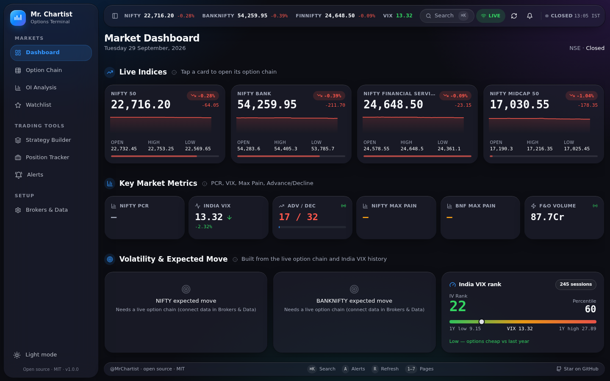
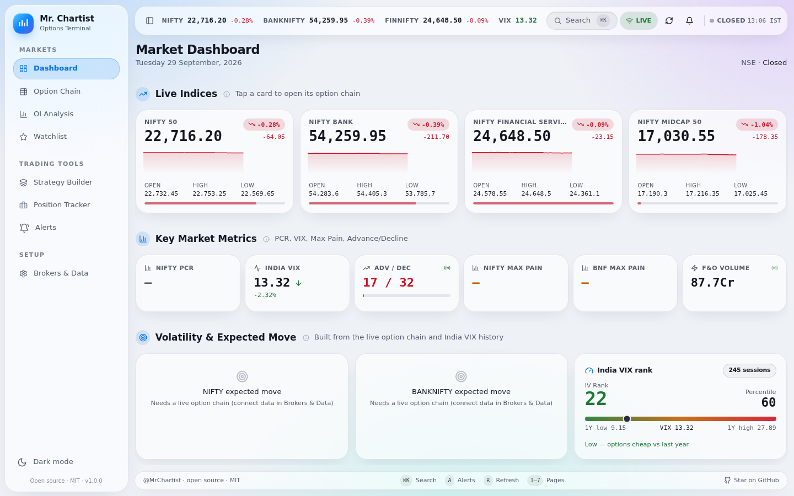
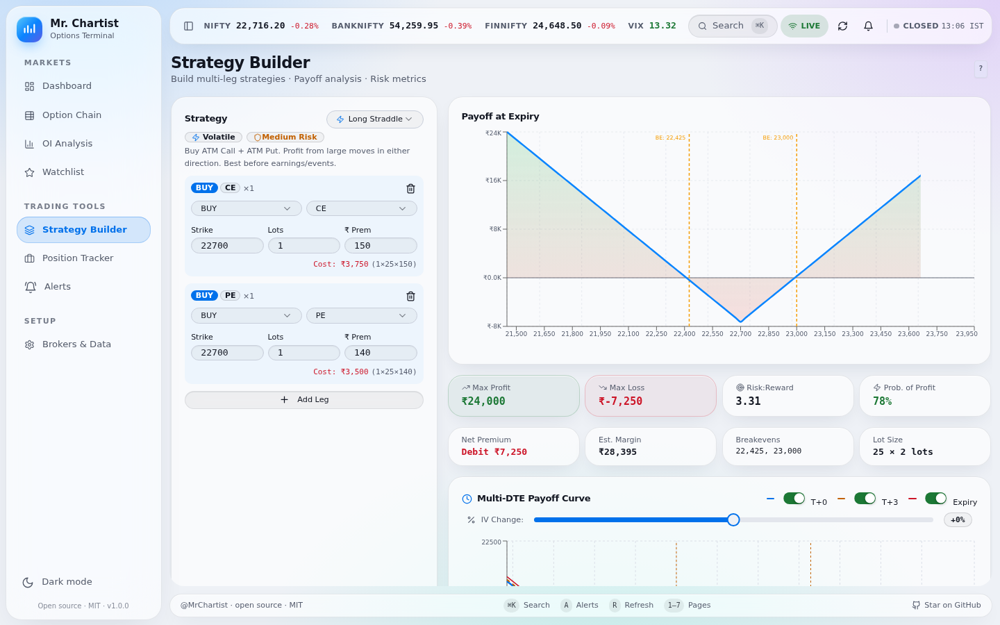
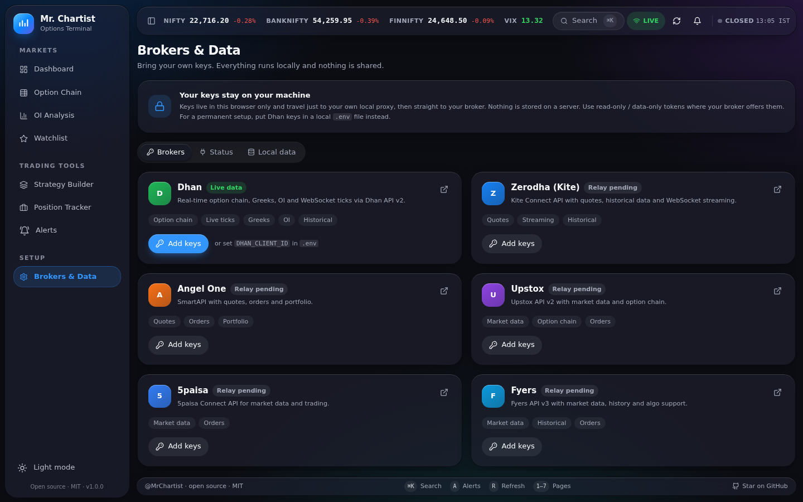
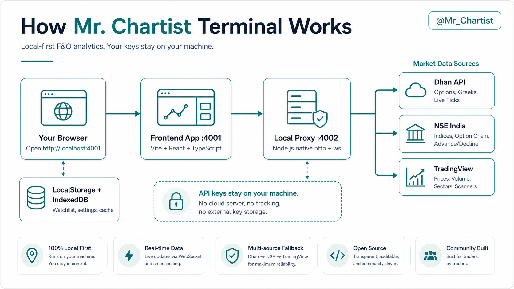

<div align="center">

**India's most comprehensive open-source Options & Futures analytics terminal.**

Built for NSE F&O traders who want a polished, institutional-style terminal -- free, open-source, and running in your browser.

Built by [**Mr. Chartist**](https://github.com/MrChartist) | Part of the [Mr. Chartist Ecosystem](https://mrchartist.com)

[](https://react.dev)
[](https://typescriptlang.org)
[](https://vitejs.dev)
[](https://tailwindcss.com)
[](LICENSE)
[](https://github.com/MrChartist/india-s-best-option-hub/pulls)

[Preview](#preview) · [Simple Setup](#start-here-no-coding-experience-needed) · [Features](#-what-you-get) · [1Cliq Trade](#-1cliq-trade-terminal) · [Quick Start](#-quick-start-5-minutes) · [Data Sources](#-data-sources) · [Contributing](#-contributing)

</div>

---

> **🚀 v1.0 — Actively Maintained**
>
> Core features are stable and production-ready. Some advanced broker integrations (Zerodha, Angel One, Upstox) have UI support but are pending backend relay implementation — contributions welcome! See the [Roadmap](#-current-status--roadmap) for what's next.
>
> Runs locally on your own machine. No hosting, no cloud database, and no required broker key for the basic dashboard experience.
>
> **Fork it, build on it, make it yours!** MIT licensed. If something doesn't make sense, use Claude/ChatGPT/Gemini to inspect the code, understand the flow, and iterate safely.

---

## Preview

<details open>
<summary><strong>🌙 Dark Mode — Market Dashboard</strong></summary>



</details>

<details>
<summary><strong>☀️ Light Mode — Dashboard</strong></summary>



</details>

<details>
<summary><strong>Polished Compact Navigation</strong></summary>


</details>

<details>
<summary><strong>🌙 Dark Mode — Option Chain</strong></summary>


</details>

<details>
<summary><strong>☀️ Light Mode — OI Analysis</strong></summary>


</details>

<details>
<summary><strong>☀️ Light Mode — Strategy Builder</strong></summary>



</details>

<details>
<summary><strong>🌙 Dark Mode — Broker Settings</strong></summary>



</details>

---

## 🧠 What Is This?

This is a **free, browser-based Options & Futures analytics terminal** for the Indian stock market (NSE).

**Think of it as your personal trading dashboard** that shows:
- Live prices of NIFTY, BANKNIFTY, and other indices
- Full option chain with OI (Open Interest), IV (Implied Volatility), and Greeks
- Charts showing where the smart money is positioned
- Tools to build and test trading strategies before risking real money

**Who is this for?**
- 📈 **Options traders** who want professional tools without paying ₹2000+/month
- 🎓 **Beginners** learning about option chains, OI analysis, and Greeks
- 💻 **Developers** who want to build on top of a solid F&O analytics platform
- 🧪 **Builders and learners** who want a real-world project to study, customize, and improve

---

## Start Here (No Coding Experience Needed)

You only need three things: **Node.js**, this project folder, and a browser. The app runs on your own computer, so you do not need to buy hosting or deploy anything.

### Windows PC

1. Install **Node.js LTS** (v20 or newer) from [nodejs.org](https://nodejs.org/).
2. Download this project as a ZIP from GitHub and extract it, or clone it with Git.
3. Open the extracted project folder.
4. Click the folder address bar, type `cmd`, and press **Enter**. A terminal opens inside the project.
5. Run `npm install`.
6. Run `npm run dev`.
7. Open `http://localhost:4001` in Chrome, Edge, or Brave.

### Mac

1. Install **Node.js LTS** (v20 or newer) from [nodejs.org](https://nodejs.org/).
2. Download this project as a ZIP from GitHub and unzip it, or clone it with Git.
3. Open **Terminal**.
4. Type `cd `, drag the project folder into Terminal, and press **Enter**.
5. Run `npm install`.
6. Run `npm run dev`.
7. Open `http://localhost:4001` in Safari, Chrome, or Brave.

Keep the terminal window open while using the dashboard. To stop the app, click the terminal and press `Ctrl+C`.

You can use the basic dashboard without broker credentials. Add a free Dhan API key only if you want the best option-chain, Greeks, and live tick experience.

---

## ✨ What You Get

| Feature | What It Does | Status |
|---------|-------------|--------|
| **📊 Live Dashboard** | Real-time NIFTY, BANKNIFTY prices, VIX, sector heatmap, market sentiment score | ✅ Working |
| **⛓️ Option Chain** | Full strike-wise data — LTP, OI, OI Change, Volume, IV for every CE/PE strike | ✅ Working |
| **📈 OI Analysis** | ATM zone, OI heatmap, support/resistance, IV/PCR modules, and 10 analysis tabs | ✅ Working |
| **🧮 Strategy Builder** | Build Bull Call Spread, Iron Condor, Straddle — see payoff chart before you trade | ✅ Working |
| **💼 Position Tracker** | Track your open positions with real-time P&L | ✅ Working |
| **⚡ 1Cliq Trade** | Keyboard-driven one-click execution terminal: arming model, server-side SL/target engine, F6 close all, F7 cancel all, trading lock | 🧪 Beta (paper-first) |
| **📋 Orders** | Today's real Dhan order book with cancel for resting orders | 🧪 Beta |
| **⭐ Watchlist** | Save your favorite stocks for quick access | ✅ Working |
| **🔑 Broker API Keys** | Connect Dhan, or another broker's API key, for live data (BYOK) | ✅ Working (Dhan fully connected) |
| **📡 WebSocket Live Feed** | Real-time price ticks via Dhan WebSocket binary protocol | ✅ Working |
| **🗄️ Local Database** | IndexedDB-based persistence for price snapshots and candle history | ✅ Working |
| **📥 Chart Downloader** | Batch download OHLCV candles via Yahoo Finance (free, no API key) | ✅ Working |

### Dashboard Sections

The dashboard is packed with live data widgets:

- **Index Cards** — NIFTY 50, BANK NIFTY, FINNIFTY, MIDCAP NIFTY with live prices & intraday sparklines
- **Data Sources Bar** — Real-time status of all 6 data sources (Dhan API, Dhan WS, Live Feed, NSE, TradingView, VIX)
- **Key Metrics** — PCR, VIX, Max Pain for NIFTY and BANKNIFTY
- **Expected Move** — How much NIFTY/BANKNIFTY might move before expiry (based on IV)
- **IV Rank Scanner** — Scans major stocks for IV Rank with buy/sell signals
- **Top Movers** — Today's biggest gainers and losers in F&O
- **Futures & VIX** — Premium/Discount analysis and VIX trend charts
- **Sector Performance** — Color-coded sector heatmap showing money flow
- **Most Active F&O** — Stocks with highest trading activity + OI interpretation
- **Market Breadth** — Overall market health score, Advance/Decline ratio, VIX regime

---

## ⚡ 1Cliq Trade Terminal

A keyboard-first execution terminal at `/one-cliq` (`g` `t`). The full build spec and roadmap are in [`1CLIQ-TRADE-SPEC.md`](1CLIQ-TRADE-SPEC.md).

**Live trading is off by default.** Fills are simulated paper trades until you turn on **Live trading** in Broker Settings, acknowledge the real-money warning, and arm the terminal (`O`). Arming never persists across a reload and auto-disarms when idle.

The risk engine lives on the proxy, not in the browser tab: every Dhan tick goes to the in-process `tickBus` and the server risk engine **before** it is sent to browsers, so a closed or throttled tab cannot delay an exit.

- **Keyboard layer:** arrow keys for market orders, `+`/`-` lots, `1`-`5` lot presets, `F6` close all (press twice), `F7` cancel all, `O` arm, `Esc` disarm, `?` cheat sheet.
- **Server risk engine** (`server/lib/riskEngine.mjs`): spot-referenced SL/target, trailing ratchet, position state machine and a 1 s dead-man's switch. The armed badge renders only from the server heartbeat. **Real exit orders are not wired yet**: the engine calls an injectable stub.
- **Panic layer** (`server/lib/panicLayer.mjs`), wired to real Dhan calls: close all runs cancel-all first, then closes shorts, hedges and futures in three waves with a barrier between them. Both always re-fetch the authoritative book from Dhan (never a client-supplied list) and report success only after re-verifying it.
- **Trading lock** with a server-computed cooling-off and a typed-figure ritual to clear a loss-triggered lock.
- **Save as basket** in Strategy Builder resolves legs against the live chain and saves them. It **never places orders**.
- **Orders page** (`/orders`) and portfolio read endpoints (`positions`, `holdings`, `funds`, `trades`, `modify-order`).

Trading endpoints live on `/api/dhan-proxy?endpoint=…`, behind the same Host and Origin allowlists as the rest of the proxy. Anything that changes state is POST-only with a JSON body, and callers without an Origin header are accepted only from this machine.

---

## 🚀 Quick Start (5 Minutes)

### Prerequisites

| Tool | Version | Download |
|------|---------|----------|
| **Node.js** | v20 or higher (v22 LTS recommended) | [nodejs.org](https://nodejs.org/) |
| **Git** | Any recent version | [git-scm.com](https://git-scm.com/downloads) |
| **Code Editor** | Optional but recommended | [VS Code](https://code.visualstudio.com/) |

> **New to coding?** Don't worry! Just follow the steps below. If you get stuck, copy the error message and ask ChatGPT/Claude/Gemini for help.

### Step 1: Clone the Repository

**Option A: Using Git (recommended)**

Open your terminal (Command Prompt, PowerShell, or Terminal on Mac/Linux) and run:

```bash
git clone https://github.com/MrChartist/india-s-best-option-hub.git
cd india-s-best-option-hub
```

**Option B: Download ZIP (no Git needed)**

1. Go to [github.com/MrChartist/india-s-best-option-hub](https://github.com/MrChartist/india-s-best-option-hub)
2. Click the green **"Code"** button → **"Download ZIP"**
3. Extract the ZIP file to any folder
4. Open a terminal in that folder

### Step 2: Install Dependencies

```bash
npm install
```

This downloads all the libraries the project needs. Wait for it to finish (~1-2 minutes on first install).

> **Getting errors?** Make sure Node.js is installed by running `node --version`. You should see `v20.x.x` or higher. If not, [download Node.js](https://nodejs.org/).

### Step 3: Start the App

```bash
npm run dev
```

This starts **two servers simultaneously**:

| Server | URL | Purpose |
|--------|-----|---------|
| **Vite** (frontend) | `http://localhost:4001` | The React app you see in the browser |
| **Proxy** (data relay) | `http://localhost:4002` | Routes data from Dhan/NSE/TradingView |

**Open your browser and go to:** `http://localhost:4001`

🎉 **That's it!** You should see the dashboard loading. During market hours (Mon–Fri, 9:15 AM – 3:30 PM IST), live data from TradingView and NSE will populate automatically — no API key needed for basic data.

### What Works Without API Keys

| Works immediately | Needs optional Dhan key |
|-------------------|-------------------------|
| Dashboard overview, index cards, watchlist, sector flow, scanners, and many fallback data widgets | Full Dhan option chain, Greeks, expiry metadata, and live WebSocket ticks |
| Local settings, local watchlist, browser storage, and theme preferences | Highest-quality real-time derivatives data |
| Yahoo Finance historical candle downloads | Broker-specific authenticated endpoints |

### Sample-data mode (no proxy, no keys)

Want to look around outside market hours, or without running the proxy?

```bash
VITE_DATA_MODE=sample npm run dev:vite
```

With no proxy reachable, pages show either an empty state or clearly labelled sample data (look for the **Sample data** badge). `VITE_DATA_MODE=sample` tells the data layer to skip the proxy and go straight to sample data. Sample numbers are for demonstration only and are never shown as live prices. The Playwright smoke tests run in this mode.

### Step 4 (Optional): Add Dhan API for Premium Data

For the best experience (real-time option chain, Greeks, live WebSocket ticks):

1. **Create a Dhan account** at [dhan.co](https://dhan.co) (free)
2. **Get API credentials** from [Dhan Developer Portal](https://dhanhq.co/docs/v2/)
3. **Create a `.env` file** in the project root:

```bash
# Windows
copy .env.example .env

# Mac/Linux
cp .env.example .env
```

4. **Add your credentials** to `.env`:

```env
DHAN_CLIENT_ID=your_client_id_here
DHAN_ACCESS_TOKEN=your_access_token_here
```

5. **Restart the app** (press `Ctrl+C` to stop, then run `npm run dev` again)

The proxy server will automatically detect your Dhan credentials and connect to the Dhan WebSocket for live ticks.

> **📝 Note:** You can also add Dhan credentials from the UI itself — go to **Broker Settings** page (`/broker-settings`) and enter your keys there. They're stored in your browser's localStorage and never sent to any external server.

### Step 5 (Optional): Add Other Broker Keys

Dhan is the reference integration (option chain, Greeks, the live feed and 1Cliq orders). Under **Other brokers** in Broker Settings you can also add an API key for the brokers in `server/brokers/registry.mjs` (Zerodha, Upstox, Fyers, Flattrade, Shoonya, Zebu and more). The active broker then supplies option chains and expiries through `/api/broker-proxy`; the live feed and 1Cliq orders stay on Dhan.

Brokers whose APIs cannot log in without your password, MPIN or TOTP secret (for example Angel One, 5paisa, Kotak Neo) are listed but not available, because the terminal never stores those.

---

## 🐳 Running with Docker

The image is a production build: `dist/` is served on port **4001** and the data proxy runs on port **4002**, as a non-root user, with a health check. Broker keys are never baked into the image; they are read from `.env` at runtime.

### Docker Compose (recommended)

```bash
git clone https://github.com/MrChartist/india-s-best-option-hub.git
cd india-s-best-option-hub
cp .env.example .env        # optional: add Dhan keys
docker compose up --build
```

Open `http://localhost:4001`. Both ports are bound to `127.0.0.1` only, because the proxy can hold your broker token.

### Plain Docker

```bash
docker build -t mrchartist-terminal .
docker run --rm -p 127.0.0.1:4001:4001 -p 127.0.0.1:4002:4002 --env-file .env mrchartist-terminal
```

Leave out `--env-file .env` if you have no keys yet. Check health with `curl http://localhost:4002/health`.

| Setting | How |
|---------|-----|
| Different host ports | `-p 127.0.0.1:5001:4001 -p 127.0.0.1:5002:4002`, and rebuild with `--build-arg VITE_PROXY_URL=http://localhost:5002` |
| Proxy on another host | `--build-arg VITE_PROXY_URL=https://proxy.example.com` and set `PROXY_ALLOWED_ORIGINS` at runtime |
| Hot reload while coding | Use `npm run dev` on your machine; the image is for running, not developing |

---

## 📡 Data Sources

The terminal uses **4 data sources** with automatic failover:

```
Priority: Dhan API (1st) → NSE India (2nd) → TradingView (3rd) → Yahoo Finance (Charts)
```

| Source | What It Provides | Auth Needed? | Accuracy |
|--------|-----------------|-------------|----------|
| **Dhan API** ⭐ | Option Chain, Greeks, Expiry List, Live WebSocket Ticks | Yes (free API key) | Real-time |
| **NSE India** | Indices, Sectors, Advance/Decline, Option Chain (fallback) | No | 3-5 sec delay |
| **TradingView** | 100+ F&O stock prices, Volume, Sector data | No | 15-30 sec delay |
| **Yahoo Finance** 🆕 | Historical OHLCV charts for all NSE stocks & indices | No | EOD / 15min delay |

### How the Data Flows

```
Your Browser  ←→  Local Proxy Server (:4002)  ←→  Dhan / NSE / TradingView
      ↑                    ↑
      │                    │
   React App          Handles CORS,
   (port 4001)        caching, retry,
                       WebSocket relay
```

1. Your browser sends requests to the **local proxy server** (runs on your machine)
2. The proxy forwards requests to Dhan/NSE/TradingView APIs
3. The proxy caches responses (3–30 seconds) to avoid rate limits
4. Data flows back to your browser in real-time
5. Dhan WebSocket data is parsed from binary and relayed as clean JSON to the browser

> **🔒 Security:** Your API keys never leave your machine. The proxy runs 100% locally — no external servers, no cloud, no tracking. Broker keys stored in the browser are kept in localStorage only.

### Data Source Status Bar

The dashboard shows a **real-time status bar** at the top with all 6 source indicators:

| Indicator | Meaning |
|-----------|---------|
| 🟢 **Dhan API** | Primary data source — Option Chain, Greeks |
| 🟢 **Dhan WS** | WebSocket live ticks — Index prices, VIX |
| 🟢 **Live Feed** | Browser receiving WebSocket data |
| 🟢 **NSE** | Fallback — Indices, Sectors, A/D ratio |
| 🟢 **TradingView** | F&O stock scanner — LTP, Volume |
| 🟢 **VIX** | India VIX from WebSocket or NSE |

Hover over any indicator to see detailed connection info, including tick count, cached data, and connected clients.

---

## 📖 Pages Guide

### 1. Dashboard (`/`)

The main dashboard with 10+ live data sections. Everything refreshes automatically during market hours.

**Key sections:**
- **Ticker Tape** — Scrolling prices at the top
- **Index Cards** — Click any card to open its option chain
- **Key Metrics** — PCR, VIX, Max Pain
- **IV Rank Scanner** — Shows if options are cheap or expensive
- **Market Breadth** — Overall market health with sentiment score (0–100)

### 2. Option Chain (`/option-chain`)

Full option chain for any F&O symbol — NIFTY, BANKNIFTY, FINNIFTY, MIDCPNIFTY, or individual stocks.

**Features:**
- All strikes with CE/PE data (LTP, OI, OI Change, Volume, IV)
- ATM (At-The-Money) strike auto-highlighted
- Switch between expiry dates
- PCR and total OI shown in the header
- Click any row for quick trade actions

### 3. OI Analysis (`/oi-analysis`)

Deep analysis of Open Interest data with summary cards, ATM zone analysis, OI heatmap, support/resistance, multi-expiry context, IV/PCR modules, and 10 analysis tabs:

| Tab | What It Shows |
|-----|--------------|
| **Delta OI** | Directional exposure at each strike |
| **Strike PCR** | Put-Call ratio per strike |
| **OI Correlation** | OI, OI change, and volume relationships |
| **OI Distribution** | Where Call/Put writers are concentrated |
| **OI Change** | Strike-wise change in open interest |
| **Multi-Expiry** | Weekly vs Monthly OI comparison |
| **IV Smile** | Implied Volatility skew across strikes |
| **PCR Trend** | Live PCR gauge + OI breakdown |
| **OI Interpretation** | Buildup, unwinding, short covering, and active strikes |
| **Top Strikes** | Highest call and put OI strikes |

### 4. Strategy Builder (`/strategy-builder`)

Build any options strategy and see its payoff chart before trading.

**Pre-built strategies:** Bull Call Spread, Bear Put Spread, Long Straddle, Iron Condor, Butterfly, Collar, and more.

### 5. Position Tracker (`/position-tracker`)

Track your open option positions with simulated P&L.

### 6. Watchlist (`/watchlist`)

Save your favorite F&O symbols for quick access.

### 7. Broker Settings (`/broker-settings`)

Configure your broker API credentials, see real-time connection status for all data sources, and turn Live trading (1Cliq Trade) on or off. BYOK (Bring Your Own Key) architecture.

---

## ⌨️ Keyboard Shortcuts

Press `g`, then a letter, to jump between pages (like Gmail or GitHub). Shortcuts are ignored while you are typing in a field or a dialog is open.

| Shortcut | Action |
|----------|--------|
| `g` `d` | Dashboard |
| `g` `c` | Option Chain |
| `g` `o` | OI Analysis |
| `g` `s` | Strategy Builder |
| `g` `v` | Volatility |
| `g` `x` | Gamma Exposure |
| `g` `f` | Options Flow |
| `g` `t` | 1Cliq Trade |
| `g` `p` | Position Tracker |
| `g` `l` | Learn |
| `/` or `Ctrl+K` | Search / command palette |
| `R` | Refresh market data |
| `Alt+A` | Alerts |
| `?` | Show all shortcuts |
| `Esc` | Close panels |

The list is generated from the route registry in `src/lib/routes.ts`.

---

## 🧱 Tech Stack

| What | Technology | Why |
|------|-----------|-----|
| **Frontend** | React 18 + TypeScript | Modern, type-safe UI with component reuse |
| **Build Tool** | Vite 5 | Instant hot-reload during development |
| **Data Fetching** | TanStack React Query | Automatic caching, retry, and background refresh |
| **UI Library** | shadcn/ui + Radix | Beautiful, accessible components out of the box |
| **Styling** | Tailwind CSS 3 | Fast styling with dark/light theme support |
| **Charts** | Recharts | Interactive charts for OI, IV, and payoff diagrams |
| **Proxy Server** | Node.js (native http + ws) | Local CORS proxy — no Express, no bloat |
| **WebSocket** | ws (Node.js) | Real-time binary protocol parsing for Dhan feed |
| **Local Storage** | IndexedDB (localDatabase.ts) | Persistent price snapshots + candle history |
| **Routing** | React Router v6 | Client-side navigation between pages |

---

## 📁 Project Structure

```
india-s-best-option-hub/
├── proxy-server.mjs          # Local proxy server (Dhan + NSE + TradingView + WebSocket relay)
├── .env.example              # Environment variable template  
├── package.json              # Dependencies and scripts
├── vite.config.ts            # Vite configuration (port 4001)
├── tailwind.config.ts        # Tailwind CSS with custom design system
├── index.html                # HTML entry point with SEO meta tags
│
├── src/
│   ├── main.tsx              # App entry point
│   ├── App.tsx               # Routes and providers (React Query, Router, Toasts)
│   ├── index.css             # Design system (CSS variables, dark/light themes)
│   │
│   ├── pages/                # Each page = one route
│   │   ├── Index.tsx         # Dashboard (/) — 10+ widget sections
│   │   ├── OptionChain.tsx   # Option Chain (/option-chain)
│   │   ├── OIAnalysis.tsx    # OI Analysis (/oi-analysis) — ATM zone + 10 analysis tabs
│   │   ├── Watchlist.tsx     # Watchlist (/watchlist)
│   │   ├── StrategyBuilder.tsx # Strategy Builder (/strategy-builder)
│   │   ├── PositionTracker.tsx # Position Tracker (/position-tracker)
│   │   ├── BrokerSettings.tsx  # Broker Settings (/broker-settings)
│   │   └── NotFound.tsx      # 404 page
│   │
│   ├── components/           # Reusable UI pieces
│   │   ├── ui/               # Base components (Button, Card, Table, Badge, etc.)
│   │   ├── dashboard/        # Dashboard section widgets
│   │   │   ├── DataSourcesBar.tsx    # 6-source real-time status bar
│   │   │   ├── MarketHeader.tsx      # Market open/closed indicator
│   │   │   ├── TickerTape.tsx        # Scrolling price ticker
│   │   │   ├── IndexCards.tsx        # NIFTY/BANKNIFTY cards with sparklines
│   │   │   ├── KeyMetrics.tsx        # PCR, VIX, Max Pain cards
│   │   │   ├── TopMovers.tsx         # Gainers & losers table
│   │   │   ├── SectorHeatmap.tsx     # Color-coded sector performance grid
│   │   │   ├── MostActiveFnO.tsx     # Highest activity F&O stocks
│   │   │   ├── MarketBreadth.tsx     # Sentiment score, A/D ratio, VIX regime
│   │   │   ├── FuturesVIX.tsx        # Futures premium/discount + VIX chart
│   │   │   ├── GiftNiftyExpiry.tsx   # GIFT Nifty + expiry countdown
│   │   │   ├── WelcomeBanner.tsx     # Welcome message
│   │   │   ├── QuickTradeActions.tsx # Quick navigation cards
│   │   │   ├── SectionHeader.tsx     # Section titles with tooltips
│   │   │   └── InfoTooltip.tsx       # Educational tooltips
│   │   ├── IVPercentileGauge.tsx     # IV analysis with live smile chart
│   │   ├── IVRankWidget.tsx          # IV rank scanner (multi-symbol)
│   │   ├── ExpectedMoveWidget.tsx    # Expected move calculator
│   │   ├── DashboardLayout.tsx       # Sidebar + main content layout
│   │   ├── AppSidebar.tsx            # Navigation sidebar with all routes
│   │   ├── CommandPalette.tsx        # Cmd+K command palette
│   │   ├── AlertSystem.tsx           # Price/OI alert engine
│   │   ├── DatabaseManager.tsx       # IndexedDB price/candle manager UI
│   │   ├── ErrorBoundary.tsx         # Graceful error handling
│   │   ├── LoadingSkeletons.tsx      # Loading skeleton animations
│   │   └── ...                       # More specialized components
│   │
│   ├── hooks/                # React hooks (data fetching & state)
│   │   ├── useMarketData.ts  # All market data hooks (option chain, indices, F&O stocks)
│   │   ├── useWebSocket.ts   # WebSocket connection for live Dhan ticks
│   │   ├── useLocalDatabase.ts # IndexedDB read/write hooks
│   │   ├── useKeyboardShortcuts.ts # Global keyboard shortcuts
│   │   ├── useAlertEngine.ts # Alert engine logic
│   │   └── useTheme.ts      # Dark/light theme toggle
│   │
│   ├── lib/                  # Utility functions & core logic
│   │   ├── marketApi.ts      # API calls (Dhan → NSE → TradingView fallback chain)
│   │   ├── websocketClient.ts # Browser-side WebSocket client for Dhan relay
│   │   ├── brokerConfig.ts   # Broker definitions + localStorage key management
│   │   ├── oiUtils.ts        # OI analysis calculations (Max Pain, PCR, Delta OI)
│   │   ├── positionStore.ts  # Position tracking with lot sizes
│   │   ├── localDatabase.ts  # IndexedDB wrapper for persistent storage
│   │   ├── mockData.ts       # TypeScript type definitions and data models
│   │   └── utils.ts          # General utilities (cn helper)
│   │
│   └── test/                 # Test files
│
├── docs/
│   └── screenshots/          # App screenshots for README
│
└── public/                   # Static files
```

---

## 📜 Available Scripts

| Command | What It Does |
|---------|-------------|
| `npm run dev` | **Start everything**: Vite frontend (`:4001`) and proxy server (`:4002`) together |
| `npm run dev:vite` | Start only Vite (frontend only, no live data from the proxy) |
| `npm run proxy` | Start only the proxy server |
| `npm run build` | Production build in `dist/` |
| `npm run preview` | Serve the production build locally |
| `npm run typecheck` | TypeScript in strict mode (app, config files and e2e) |
| `npm run lint` | ESLint (`npm run lint:strict` fails on any warning) |
| `npm test` | Unit tests with Vitest |
| `npm run test:coverage` | Unit tests with coverage (90% gate on `src/lib/options/**`) |
| `npm run test:e2e` | Playwright smoke tests on every page, in sample-data mode (run `npx playwright install chromium` once) |
| `npm run format` | Format with Prettier (Tailwind classes sorted) |
| `npm run knip` | Find unused files, exports and dependencies |
| `npm run check` | Typecheck, lint, test and build: run this before opening a PR |

---

## 🔧 Troubleshooting

### "The dashboard shows no data"

- **During market hours?** Data loads automatically from TradingView/NSE. Wait 5–10 seconds.
- **After market hours?** Most data sources return empty responses. This is normal — NSE/TradingView only serve data during trading sessions.
- **Check the status bar** at the top — it shows which sources are connected. Hover over each indicator for details.
- **Proxy not running?** Make sure you used `npm run dev` (not `npm run dev:vite`).

### "npm install fails"

- Make sure you have **Node.js v20+** installed: `node --version`
- Try clearing npm cache: `npm cache clean --force` then `npm install` again
- On Windows, try running as Administrator
- On Mac/Linux, if permission errors: `sudo npm install` (not recommended long-term — fix npm permissions instead)

### "Port 4001 is already in use"

Edit `vite.config.ts` and change the port:

```ts
server: {
  port: 3000, // Change to any available port
}
```

### "Port 4002 is already in use"

Create a `.env` file and change the proxy port:

```env
PROXY_PORT=4003
```

### "Dhan API shows 429 Too Many Requests"

This means you're hitting Dhan's rate limit. The proxy caches responses to minimize this, but on weekends/holidays, Dhan may still reject requests. Wait and retry during market hours.

### "Option chain shows no data"

- Option chain data requires **Dhan API** or **NSE** to be responsive
- On weekends, both return empty responses — data will load on Monday
- Check Broker Settings page to verify your Dhan credentials
- Verify the proxy is running: visit `http://localhost:4002/health` in your browser

### "WebSocket not connecting"

- WebSocket requires valid Dhan credentials (Client ID + Access Token)
- Check `http://localhost:4002/health` — it shows `websocket.dhanConnected: true/false`
- The WS auto-reconnects with exponential backoff if disconnected

---

## 🗺️ Current Status & Roadmap

The full, prioritised plan (feature parity with Sensibull, OptionStrat and others, adapted for NSE) lives in **[ROADMAP.md](ROADMAP.md)**. How the code fits together is in **[docs/ARCHITECTURE.md](docs/ARCHITECTURE.md)**.

### ✅ What's Working Now

- Full Dashboard with 10+ live widgets
- Option Chain (Dhan primary, NSE fallback)
- OI Analysis with ATM zone, heatmap, support/resistance, and 10 analysis tabs
- Strategy Builder with payoff diagrams
- Position Tracker
- Watchlist
- Dhan WebSocket live feed with binary protocol parsing
- Proxy server with 3-source failover (Dhan → NSE → TradingView)
- Data source status bar
- Keyboard shortcuts & command palette
- Dark/Light theme
- IndexedDB local persistence
- BYOK broker key storage

### 🔧 What's Being Worked On (Next 10–30 Days)

- [ ] Full integration for Zerodha, Angel One, Upstox, Fyers APIs
- [ ] Historical OI change charts
- [ ] Options Greeks calculator with real-time Greeks from Dhan
- [ ] Multi-expiry comparison views
- [ ] Alert system with push notifications
- [ ] Advanced strategy P&L with multi-DTE scenarios
- [ ] GEX (Gamma Exposure) analysis
- [ ] FII/DII activity dashboard
- [ ] Mobile-responsive layout improvements
- [ ] Production deployment guide (Vercel + VPS proxy)

### 🤔 Known Gaps (Help Wanted!)

- Some dashboard sections may show empty during off-market hours — this is by design (no mock data)
- Zerodha/Angel One/Upstox/Fyers/5paisa/Alice Blue have UI forms but no backend connectors yet
- The Strategy Builder payoff chart doesn't integrate with live option chain pricing yet
- Some component state doesn't persist across page navigation

---

## 🌐 Deploying to Production

### Deploy on Vercel / Netlify (Frontend Only)

```bash
npm run build
```

Upload the `dist/` folder to any static hosting (Vercel, Netlify, GitHub Pages).

> **Note:** Without the proxy server, live data won't work. The frontend will show empty states gracefully. For full functionality, you need the proxy running somewhere.

### Deploy Full Stack (Frontend + Proxy)

For a complete deployment with live data:

1. Deploy the **proxy server** (`proxy-server.mjs`) on a VPS (DigitalOcean, AWS, Railway, Render, etc.)
2. Set `VITE_PROXY_URL` in `.env` to your proxy's public URL
3. Deploy the frontend on Vercel/Netlify
4. Set environment variables on the VPS: `DHAN_CLIENT_ID`, `DHAN_ACCESS_TOKEN`

---

## 🤝 Contributing

**Contributions are very welcome!** This is a community project and there's a LOT of room for improvement.

### How to Contribute

Read **[CONTRIBUTING.md](CONTRIBUTING.md)** first. Every PR must pass `npm run check` (typecheck, lint, tests, build).

1. **Fork** this repository
2. **Create** a feature branch: `git checkout -b feature/my-feature`
3. **Make changes** and commit: `git commit -m 'Add my feature'`
4. **Push** to your fork: `git push origin feature/my-feature`
5. **Open** a Pull Request

### Contribution Ideas

- 🔌 **Add a new broker connector** (Zerodha, Angel One, Upstox, etc.)
- 📊 **Improve charts** (candlestick charts, better OI visualization)
- 📱 **Mobile responsiveness** (some sections need mobile love)
- 🧪 **Add tests** (pure logic in `src/lib/**` with Vitest, pages via the Playwright smoke suite)
- 📝 **Documentation** (component docs, API docs)
- 🎨 **UI polish** (animations, better loading states)
- 🐛 **Bug fixes** (find something broken? Fix it!)

### Rules

- Write TypeScript (no plain JavaScript in `src/`)
- Use the design system (CSS variables) — no hardcoded colors
- Test in both dark and light themes
- Never present sample or derived data as live: label it visibly (a **Sample data** or **Derived** badge)
- Keep the proxy server dependency-free (only `ws` as external dep)

---

## 🧑‍💻 New to This? Start Here

If you're new to web development or this codebase, here's how to navigate:

1. **Start with `src/pages/Index.tsx`** — this is the Dashboard page. It imports and renders all dashboard widgets.
2. **Read `src/hooks/useMarketData.ts`** — this is where all data fetching happens. Understand the WebSocket → Polling → Database fallback chain.
3. **Check `src/lib/marketApi.ts`** — this is the API layer. See how Dhan → NSE → TradingView fallback works.
4. **Look at `proxy-server.mjs`** — the Node.js proxy server that handles CORS, caching, and WebSocket relay.
5. **Use AI tools!** Copy any file into Claude/ChatGPT and ask "explain this code" — it works great for understanding the architecture.

### Architecture Overview



The terminal is intentionally local-first: the React app runs at `http://localhost:4001`, the local proxy runs at `http://localhost:4002`, and your broker credentials stay on your own machine.

---

## ⚠️ Disclaimer

This project is for **educational and analytical purposes only**. It is **not financial advice**.

- Trading in derivatives involves significant risk and may result in loss of capital
- Always do your own research and consult a registered financial advisor (SEBI-registered)
- The developers are not responsible for any financial losses
- This tool does not execute trades — it is an analytics-only platform
- API keys are stored locally and never transmitted to external servers

---

## 📄 License

This project is licensed under the **MIT License** — see [LICENSE](LICENSE) for details.

You are free to use, copy, modify, merge, publish, distribute, sublicense, and/or sell copies. Just include the original license.

---

<div align="center">

**Built with care by [Mr. Chartist](https://github.com/MrChartist) for the Indian Options Trading Community**

*If this project helps your trading, consider giving it a star on GitHub!*

*Found a bug? Have an idea? [Open an issue](https://github.com/MrChartist/india-s-best-option-hub/issues) or submit a PR!*

<br/>

<a href="https://mrchartist.com"></a>
<a href="https://github.com/MrChartist"></a>

</div>


